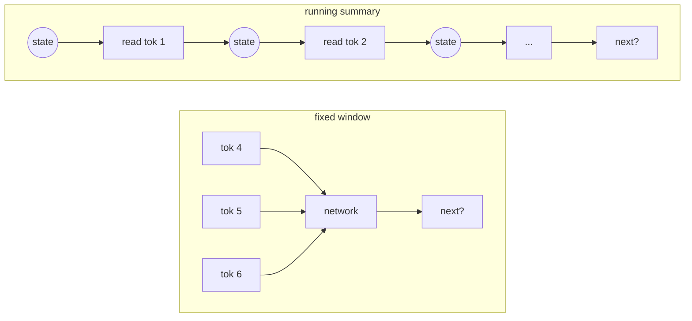

# Chapter 4: Before Attention: N-grams and RNNs

*LLMs 101, Part I — One Function.
[Series index](index.html) · [Prev](03-embeddings.md) ·
[Next: Attention](05-attention.md)*

---

**The failure this chapter is about:** the bigram model looks one token
back. Everything interesting in language is further back than that. "The
file the agent edited *was*" versus "the files the agent edited *were*":
the verb depends on a word five tokens ago. Fixing this is the entire
history of language modelling before 2017, and knowing that history is
what makes attention feel obvious instead of clever.

Here's the conclusion first. Before attention, a model had exactly two ways
to see context, and both broke:

> **A fixed window** (n-grams, then neural n-grams): look at the last *k*
> tokens, no more. Cheap and parallel, but *k* is small and hard-coded.
>
> **A running summary** (recurrent networks): read tokens one at a time,
> keeping a fixed-size memory that gets updated at each step. Sees the whole
> sequence in principle, but forgets, and can only be run one token at a
> time.

Attention was invented as a patch to the second one, then someone noticed
the patch did all the work and deleted the rest. This chapter is the two
failures. Chapter 5 is the patch. There is no code in this chapter; it's
the shortest useful history.

## The fixed window: n-grams

The obvious extension of the bigram table is to look two tokens back
instead of one. Count every triple instead of every pair: after `t`,`h` the
next character is almost certainly `e`, `a`, `i` or `o`. That's a
**trigram** model. Look three back and it's a 4-gram. Each step back makes
the predictions sharper, and you can feel where this goes.

It goes into a wall, fast. With 99 characters, the bigram table has about
10,000 possible rows. The trigram table has about a million. A 5-gram has
nearly ten billion. Almost all of those rows are empty, because the
training text never contained that exact sequence, and an empty row means
the model has no idea what comes next. Statisticians spent the 1980s and
90s inventing clever ways to fill empty rows from shorter contexts
("smoothing"), and it worked well enough that n-gram models ran speech
recognition and machine translation for two decades. But the window stayed
at four or five tokens, because the table had to fit in memory and the
counts had to be nonzero.

In 2003, Yoshua Bengio's group replaced the table with a small neural
network. Take the last *k* tokens, look up each one's embedding (chapter
3), concatenate the vectors, push them through a couple of layers, and read
off the next-token probabilities. Because tokens now live in a shared
space, the model can generalise: it can predict what follows "the agent
ran" even if it has only ever seen "the harness ran". The empty-row problem
is gone. But *k* is still baked into the shape of the network. The first
layer has exactly *k* times the embedding width as its input. Want to see
ten tokens back instead of five? Rebuild and retrain. Want to see a
thousand? Don't be silly.

Hold onto the fixed-window idea, though. It comes back. A transformer's
**context window** is exactly this: a hard maximum on how many tokens the
model can see. The difference is that *k* went from five to a few hundred
thousand, and every position in the window is reachable in one step. How
that became possible is chapters 5 and 14.

## The running summary: recurrent networks

The other idea is to stop looking at a window and instead *remember*.
A **recurrent neural network** (RNN) reads the sequence one token at a
time. It keeps a state vector, a few hundred numbers, and at each step it
combines the current token with the previous state to produce a new state.
The state is meant to be a summary of everything read so far. Predictions
come from the state. In principle the summary can hold information from
arbitrarily far back, and the network is the same size no matter how long
the input.

RNNs, and their more careful cousin the LSTM (long short-term memory,
1997), were the state of the art for a decade. They translated languages,
captioned images, and powered the first neural autocomplete. They also
failed in two ways that turned out to be fatal.

**They forget.** The state is a fixed-size bottleneck. Every token that
comes in has to be squeezed into the same few hundred numbers as
everything before it, and something has to give. Information from fifty
tokens ago has been overwritten fifty times by the time it's needed. LSTMs
added explicit gates to decide what to keep and what to overwrite, and
that helped, but the fundamental shape is a summary, and summaries lose
detail. Ask an LSTM translator to handle a fifty-word sentence and the end
of the translation would routinely lose track of the beginning.

**They're sequential.** To compute the state after token 500 you need the
state after token 499, which needs 498, and so on. Every step depends on
the last, so you cannot compute them at the same time. Meanwhile the
hardware that makes modern machine learning possible, the GPU, is good at
exactly one thing: doing thousands of identical operations at once. An RNN
hands it a queue. Training on a large corpus meant waiting for the sequence
to trickle through, and the wall-clock cost of that put a ceiling on how
much text anyone could afford to train on. This second failure is the one
that actually killed the RNN. The forgetting was annoying. The serial
dependency made scaling impossible.

## The patch that became the whole thing

In 2014, Dzmitry Bahdanau and colleagues were building an RNN translator
and hit the forgetting wall. Their fix: don't force the decoder to work
from one summary vector. Keep *all* the encoder's states, one per input
word, and at each output step let the decoder look back over all of them
and take a weighted average, with the weights learned so that they land on
whatever's relevant right now. Translating the word for "cat", the decoder
learns to weight the input position holding "cat". They called the
mechanism **attention**, and translation quality on long sentences jumped
immediately.

Notice what attention does to the two failures. Forgetting: gone, because
nothing is being summarised; every earlier position stays available and
gets looked up on demand. Serial dependency: still there, because there is
an RNN underneath, reading the input one token at a time.

That gap sat there for three years. Then, in 2017, a team at Google asked
the question that gives their paper its title: if the attention step is
where the useful work happens, is the RNN needed at all? Delete it. Let
every position look directly at every other position, all in one parallel
step, with attention doing the whole job of moving information around. No
state vector, no sequential loop, nothing for the GPU to wait on.

The paper was "Attention Is All You Need," and the architecture was the
**transformer**. It kept the fixed-window idea from n-grams (there is a
maximum sequence length) and the look-back idea from Bahdanau (learned,
content-based lookup over every earlier position), and threw away the
recurrence that made both slow. Every LLM you have used is a descendant.

## What you now know

- Context came in two flavours before 2017: a fixed window over the last
  few tokens, or a fixed-size running summary updated one token at a time.
- N-gram tables explode combinatorially. Neural n-grams fixed the
  generalisation problem but kept the hard-coded window.
- RNNs see arbitrary length in principle but forget in practice, and their
  step-by-step dependency makes them impossible to parallelise. The second
  problem is the one that killed them.
- Attention was a 2014 patch that let an RNN look back at every earlier
  position instead of relying on its summary. In 2017 the RNN was removed
  and attention was left to do the whole job.
- "Context window" is the n-gram window, grown enormous and made fully
  reachable.

Next: the mechanism itself. Attention is a lookup table with soft edges, and
it fits in fifteen lines of NumPy.

*[Next: Chapter 5 — Attention: A Soft Lookup](05-attention.md)*
