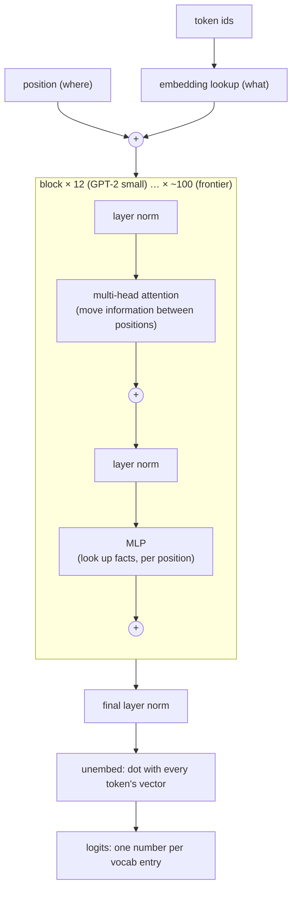

# Chapter 6: The Patches Around Attention

*LLMs 101, Part I — One Function.
[Series index](index.html) · [Prev](05-attention.md) ·
[Next: The Whole Transformer](07-the-whole-transformer.md)*

---

**The failure:** chapter 5 ended with a bare attention layer and three
problems. It can't tell where anything is, it asks only one kind of
question, and it has nowhere to store a fact. Fixing those three, plus one
more that shows up when you stack layers, is the rest of the transformer.

Here's the conclusion:

> **A transformer is attention plus four patches, stacked.** Add a position
> signal so order isn't lost. Run several small attentions side by side so
> several questions get asked at once. Follow each attention with a plain
> two-layer network where facts live. Wrap every layer in "add, don't
> replace" so you can stack dozens of them without training falling apart.
> Then stack a dozen or a hundred copies.

That's the entire architecture from "Attention Is All You Need," minus the
encoder half that GPT-style models dropped. Every patch fixes a failure you
can name, and none of them is deep. This chapter is each one in turn. The
next chapter runs them all, in NumPy, on real weights.

## Patch 1: positions, because deleting the RNN lost the order

Recurrence gave you word order for free: tokens arrived one at a time, so
the state after token five knew it came after token four. Attention has no
such thing. It computes the same outputs whether the input is "dog bites
man" or "man bites dog." The mechanism is a set lookup, and sets have no
order.

The fix is to *tell* each token where it is, by adding a "position vector"
to its embedding before anything else happens. In GPT-2 that's a second
lookup table, `wpe`, with one learned row per position, 1,024 of them:

```python
x = W["wte.weight"][ids] + W["wpe.weight"][np.arange(len(ids))]   # what + where
```

Token 41236 at position 7 becomes "the ` strawberry` vector plus the
position-7 vector." Attention can now learn questions like "what's the
token right before me?" because "right before me" is expressible in the
numbers.

The original paper used fixed sine waves of different frequencies instead
of a learned table, which works about as well. Both share a limit: a
position the model never saw during training has no meaningful vector.
GPT-2 stops dead at 1,024 tokens. Modern models mostly use a different
trick called **rotary position embedding** (RoPE): instead of adding a
position vector, rotate each query and key by an angle proportional to its
position. Two vectors rotated by angles *a* and *b* have a dot product that
depends only on *a − b*, so attention scores end up depending on the
*distance* between two tokens rather than their absolute positions. That
generalises better to lengths the model hasn't seen, and it's the lever
the industry pulled to stretch context windows from 4k to a million tokens.
Chapter 14 covers how far that lever bends before it breaks.

## Patch 2: multiple heads, because one question isn't enough

A single attention layer learns one notion of relevance. But a token in
real text needs several at once. The verb needs its subject. A pronoun
needs its referent. A closing bracket needs its opener. A word needs the
previous occurrence of itself.

So run several attentions in parallel, each with its own small `Wq, Wk,
Wv`, and concatenate their outputs. Each one is called a **head**. GPT-2
small has 12 heads per layer, each working in 64 dimensions instead of the
full 768. Here's the plumbing, from the forward pass in chapter 7:

```python
qkv = x @ p["attn.c_attn.weight"] + p["attn.c_attn.bias"]   # (T, 2304): Q, K, V for all heads in one matmul
q, k, v = np.split(qkv, 3, axis=-1)
split = lambda m: m.reshape(T, N_HEAD, 64).transpose(1, 0, 2)  # (12, T, 64): one attention per head
q, k, v = split(q), split(k), split(v)
scores = q @ k.transpose(0, 2, 1) / np.sqrt(64)               # (12, T, T)
out = softmax(masked(scores)) @ v                             # (12, T, 64)
out = out.transpose(1, 0, 2).reshape(T, 768)                  # glue the heads back together
return out @ p["attn.c_proj.weight"] + p["attn.c_proj.bias"]  # let heads mix
```

Nothing new is happening. It's chapter 5's function, twelve times, on
twelve slices of the vector, followed by one more matrix to let the heads'
answers combine. The total compute is the same as one big head, because
twelve 64-dimensional lookups cost what one 768-dimensional lookup costs.
The model just gets twelve independent questions for the same price. When
interpretability researchers open a trained model, they find heads that
have specialised: one tracks the previous token, one finds the earlier
copy of the current token, one attends to the subject of the sentence.
Nobody designed those. Twelve slots were provided and training filled them.

## Patch 3: the MLP, because attention stores nothing

Attention moves information between positions. It doesn't create any. If
the model knows that Paris is the capital of France, that fact is not in
any attention matrix; it's stored somewhere that gets consulted once the
right tokens have been gathered.

That somewhere is the dullest layer in the network. After every attention
layer comes a **multilayer perceptron** (MLP): two matrix multiplies with a
nonlinearity between them, applied to *each token separately*, with no
communication between positions.

```python
def mlp(x, p):
    h = gelu(x @ p["mlp.c_fc.weight"] + p["mlp.c_fc.bias"])    # 768 -> 3072
    return h @ p["mlp.c_proj.weight"] + p["mlp.c_proj.bias"]    # 3072 -> 768
```

Widen the vector four times, apply GELU (which is roughly "zero below zero,
identity above; a smooth on/off switch"), narrow it back. That's it. The
useful way to think about it: the first matrix is a bank of 3,072 pattern
detectors, each row asking "does this token's current vector look like
*this*?" The switch keeps only the detectors that fired. The second matrix
adds, for each detector that fired, a stored vector back into the token.
Detector 1,791 fires on "capital of France"-shaped vectors and writes back
a vector that pushes the output toward ` Paris`. It's a key-value memory,
learned, and it's where most of the model's parameters live: two-thirds of
every block in GPT-2, and the same ratio in most modern models. When
people say a model "knows" something, this is the layer they're pointing
at, and when chapter 9 says knowledge is compressed into the weights, these
are the weights.

## Patch 4: residuals and normalisation, because depth breaks training

The three patches above give you one **block**: attention, then an MLP.
One block isn't enough; the model needs to gather information, look up
facts about what it gathered, gather again using those facts, and so on.
GPT-2 small stacks 12 blocks. Frontier models stack around a hundred.

Stack naively and it doesn't train. Each layer's output replaces its
input, so a signal has to survive a hundred transformations to get from
the bottom to the top, and the correction signal during training (chapter
8) has to survive the same hundred on the way back down. It doesn't. The
fix is two lines you already saw in chapter 7's code:

```python
x = x + attention(layer_norm(x), p)    # add, don't replace
x = x + mlp(layer_norm(x), p)
```

**Residual connections**: every layer *adds* its output to its input rather
than replacing it. The running vector `x`, which people call the **residual
stream**, flows straight from the embedding to the final output, and each
layer makes an edit to it. A layer that has nothing useful to say can
output zero and the stream passes through unchanged. Depth becomes cheap:
a hundred small edits to one vector, instead of a hundred rewrites.

**Layer normalisation**: before each layer reads the stream, re-centre and
re-scale the token's vector so its numbers have mean zero and a standard
size. Over a hundred additions the stream's magnitude would otherwise
drift wherever it likes, and layers would be reading inputs on wildly
different scales. Normalisation is a thermostat. It has a few learned
parameters and no conceptual content, and every deep network has some
version of it. Modern models use a lighter variant called RMSNorm, which
skips the re-centring. Same job.

Neither of these is specific to transformers. Residuals come from image
networks in 2015; normalisation is older. They're what made "just stack
more layers" a viable strategy, which is what made "just make it bigger"
(chapter 9) a viable strategy.

## The whole block, and the stack

Put the four patches together and here's a transformer:



Read it top to bottom. Tokens become vectors that say *what* and *where*.
Each block lets every position gather from earlier positions (attention),
then lets every position consult the stored knowledge about what it
gathered (MLP), with both edits added to the stream. After the last block,
the final vector at each position is compared against every token's
embedding (chapter 3's unembedding), producing one score per vocabulary
entry. Softmax those and you have the function from chapter 1.

Two things worth noticing. First, the only place positions talk to each
other is inside attention. Everything else, the MLPs, the norms, the
embeddings, treats each position on its own. Second, the shape is
relentlessly repetitive. Twelve identical blocks with different numbers in
them. When you hear that a model has "96 layers," picture this diagram
with 96 copies of the middle box and nothing else changed.

## Where the 124 million parameters are

The counts for GPT-2 small, so the word "parameter" stops being abstract:

| Piece | Shape | Parameters |
|---|---|---|
| Token embeddings (`wte`), also used to unembed | 50,257 × 768 | 38.6M |
| Position embeddings (`wpe`) | 1,024 × 768 | 0.8M |
| Attention, per block (Q, K, V and output matrices) | 4 × 768 × 768 | 2.4M |
| MLP, per block (up and down matrices) | 2 × 768 × 3,072 | 4.7M |
| Layer norms, per block | tiny | 0.003M |
| **12 blocks** | | **85.1M** |
| **Total** | | **124.4M** |

Two-thirds of each block is the MLP. Nearly a third of the whole model is
the embedding table. Attention, the part with the famous name, is under
a quarter of the parameters. A "parameter" is one of these floating-point
numbers, and "7B" on a model card means seven billion of them, laid out in
exactly this pattern with bigger matrices and more blocks.

## What you now know

- Positions are added to embeddings because attention alone has no sense
  of order. Learned tables (GPT-2) hit a hard length limit; rotary
  embeddings (modern models) encode relative distance and stretch further.
- Multi-head attention is the same lookup run several times on slices of
  the vector, so several kinds of relevance are computed at once for the
  price of one.
- The MLP after each attention is a per-token key-value memory. It holds
  the facts and most of the parameters.
- Residual connections ("add, don't replace") and layer normalisation are
  what let you stack a hundred blocks and still train. Neither is
  transformer-specific.
- A transformer is one block, repeated, with an embedding table at the
  bottom and its transpose at the top.

Next: no more pieces. The complete forward pass, in NumPy, loading the real
GPT-2 weights, with English coming out the other end.

*[Next: Chapter 7 — The Whole Transformer in 200 Lines](07-the-whole-transformer.md)*
