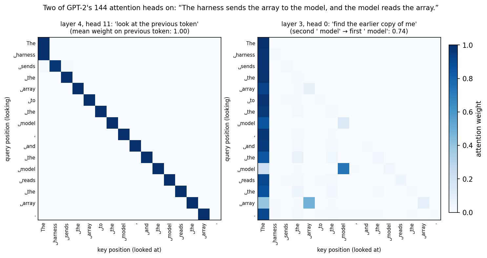

# Chapter 7: The Whole Transformer in 200 Lines

*LLMs 101, Part I — One Function.
[Series index](index.html) · [Prev](06-the-patches-around-attention.md) ·
[Next: Loss and Gradient Descent](08-loss-and-gradient-descent.md)*

---

**The failure this chapter patches is in you:** the suspicion that there
must be more to it. Six chapters of pieces, each of them small, and surely
the real thing has some extra machinery that the tutorials leave out.

It doesn't. This chapter is
[`gpt/v3_forward.py`](https://github.com/IsuruMaduranga/harness-engineering-101/blob/main/llms-101/src/gpt/v3_forward.py):
the complete GPT-2 forward pass in NumPy, loading the actual 124-million
parameter weights OpenAI released in 2019, generating text. About sixty
lines of model, forty of loading and printing, and no import other than
`numpy` and the tokenizer from chapter 2.

> **Everything that runs when a language model produces a token is in this
> file.** A lookup, twelve repetitions of the block from chapter 6, one
> matrix multiply against the embedding table. The intelligence is not in
> the code. It's in the 124 million numbers the code multiplies by, and
> Part II is about where those came from.

The body book called this a black box and asked you not to look inside.
Look inside.

## A model file is a dictionary of arrays

The weights come as one 548 MB file in the `safetensors` format, and the
format is nearly nothing: an 8-byte length, a JSON header saying which
named tensor has which shape and lives at which byte offset, then the raw
bytes.

```python
def load_safetensors(path):
    with open(path, "rb") as f:
        (n,) = struct.unpack("<Q", f.read(8))
        header = json.loads(f.read(n))
        data = f.read()
    out = {}
    for name, meta in sorted(header.items()):
        if name == "__metadata__" or name.endswith(".attn.bias"):   # stored mask buffers, not weights
            continue
        a, b = meta["data_offsets"]
        out[name] = np.frombuffer(data[a:b], dtype=np.float32).reshape(meta["shape"])
    return out
```

Run it and count:

```
148 weight tensors, 124,439,808 parameters
block 0, in full:
  h.0.attn.c_attn.weight       (768, 2304)
  h.0.attn.c_attn.bias         (2304,)
  h.0.attn.c_proj.weight       (768, 768)
  h.0.attn.c_proj.bias         (768,)
  h.0.ln_1.weight / bias       (768,) (768,)
  h.0.ln_2.weight / bias       (768,) (768,)
  h.0.mlp.c_fc.weight          (768, 3072)
  h.0.mlp.c_fc.bias            (3072,)
  h.0.mlp.c_proj.weight        (3072, 768)
  h.0.mlp.c_proj.bias          (768,)
plus:
  wte.weight                   (50257, 768)
  wpe.weight                   (1024, 768)
  ln_f.weight / bias           (768,) (768,)
```

The parameter count matches chapter 6's table to the digit. Twelve blocks
of twelve tensors each, plus the two embedding tables and a final norm.
That's the whole inventory. When someone hands you a "model," this is what
they're handing you: a dictionary from names to arrays of floats, 548 MB
because 124 million numbers times four bytes each. (Chapter 17's
quantization is the observation that you don't need all four bytes.)

## The forward pass

The building blocks are the ones from chapters 5 and 6. `gelu`, `softmax`,
`layer_norm`, `attention` and `mlp` are in the file exactly as those
chapters showed them, so here's only the part that puts them together:

```python
def layers(W, n_layer=12):
    return [{k.split(f"h.{i}.", 1)[1]: v for k, v in W.items() if k.startswith(f"h.{i}.")}
            for i in range(n_layer)]

def gpt2(ids, W, n_layer=12):
    """Token ids in (T,), logits out (T, vocab). The one function."""
    x = W["wte.weight"][ids] + W["wpe.weight"][np.arange(len(ids))]  # what + where
    for p in layers(W, n_layer):                                     # 12 identical blocks, different numbers
        x = x + attention(layer_norm(x, p["ln_1.weight"], p["ln_1.bias"]), p)
        x = x + mlp(layer_norm(x, p["ln_2.weight"], p["ln_2.bias"]), p)
    x = layer_norm(x, W["ln_f.weight"], W["ln_f.bias"])
    return x @ W["wte.weight"].T                                     # unembed with the same table, transposed
```

Read `gpt2` slowly, because it's the sentence from chapter 1 made literal.
Token ids in. Look up what and where (chapter 3, chapter 6 patch 1).
Twelve times: attend, add; consult the MLP, add (chapters 5 and 6). One
last normalisation. Compare against every token's row (chapter 3). Scores
for every token out. Softmax those and you have the next-token
distribution. Eight lines.

The generation loop is chapter 1's, verbatim in spirit:

```python
def generate(prompt, W, tok, n=20):
    ids = tok.encode(prompt)
    for _ in range(n):
        logits = gpt2(np.array(ids), W)      # recompute EVERYTHING every step (chapter 13 fixes this)
        ids.append(int(logits[-1].argmax()))  # greedy: most likely token
    return tok.decode(ids)
```

## Run it

```
after 'The capital of France is', the top next tokens:
  0.085  ' the'
  0.048  ' now'
  0.046  ' a'
  0.032  ' France'
  0.032  ' Paris'
```

Those are the real probabilities from the real model. Sit with them a
moment. The most likely continuation of "The capital of France is" isn't
Paris; it's " the", at 8.5%, because in web text that sentence usually
continues "the capital of the French Republic" or "the largest city in".
Paris is fifth at 3.2%. This is a 2019 model with 124 million parameters
and it's not very good, but it's not *wrong*: it has learned what English
text looks like after those five tokens, and English text mostly doesn't
say Paris right there. A frontier model puts Paris at the top because it's
a thousand times bigger and has been post-trained to answer questions
(chapter 10). Same code. Different numbers, and more of them.

Now generate greedily, always taking the top token:

```
> The capital of France is the capital of the French Republic, and the capital
  of the French Republic is the capital of the French Republic.
  (3.5s for 25 tokens, recomputing the whole prompt every step)

> def fibonacci(n):

return n

def fibonacci(n):

return n
```

Two things to notice, both of which get their own chapter. First, it
loops. Greedy decoding on a small model falls into a repetition trap:
once "the capital of the French Republic" has appeared, it's the most
likely thing to appear again. That's chapter 15, and it's why nobody
serves a model with `argmax`. Second, it's slow: three and a half seconds
for 25 tokens, because every step re-runs all 25-plus tokens through all
twelve layers, redoing work that hasn't changed. That's chapter 13.

Also notice what it got right. It knows that `def fibonacci(n):` is
followed by an indented body, and that `return n` is a plausible body. It
knows "the French Republic" is a way to refer to France. It has never been
told any of this. Those facts are in the MLP weights (chapter 6 patch 3),
put there by chapter 9.

## Two of the 144 heads, looking

Chapter 5 promised that trained attention weights are worth looking at.
[`diagrams/gen_attention_heatmap.py`](https://github.com/IsuruMaduranga/harness-engineering-101/blob/main/llms-101/src/diagrams/gen_attention_heatmap.py)
runs the forward pass above on one sentence, keeps the weights from every
head in every layer (12 × 12 = 144 of them), and plots two that it finds by
searching for a pattern:



The left head, layer 4 head 11, puts weight 1.00 on the previous token at
every position. It's a **previous-token head**, and it's doing exactly
chapter 6's "what's the token right before me?" lookup, made possible by
the position vectors. The right head, layer 3 head 0, does something more
interesting: at the second ` model`, it looks back at the first ` model`
with weight 0.74, and at the second ` array` it looks back at the first
` array`. It's finding the earlier copy of the current token. Appendix D
explains why that's the most important circuit in a transformer.

Look at the right panel's first column, too. Almost every row puts a large
weight on `The`, the first token, regardless of content. That's an
**attention sink**: softmax forces every row to sum to one, and a head with
nothing useful to look at dumps the surplus on position zero. Chapter 14
explains why that makes the front of your prompt structurally important.

Nobody designed either head. Twelve slots per layer were provided, and
gradient descent (chapter 8) filled them.

## What isn't in the file

I want to be explicit about the absences, because they're the point.

There's no framework. No PyTorch, no TensorFlow, no CUDA. Those exist to
make training fast and to run on GPUs; they're not where the model *is*.
The model is the arrays.

There's no rule engine, no grammar, no knowledge base, no separate
"reasoning module." Every capability you've seen a model exhibit, from
answering questions to writing code to calling tools, is produced by this
loop: embed, attend, MLP, repeat, unembed, pick. Whatever else is claimed
about a model, if it runs, it runs through something shaped like this.

There's no memory between calls. `gpt2` is a pure function of `ids` and
`W`. Call it twice with the same input and get the same logits. All the
state is in the sequence you pass in, which is why the body book's
"stateless API" wasn't a design choice by the provider; it's the shape of
the underlying function.

## From GPT-2 to a frontier model

The honest question is how much of this file survives in a 2026 model.
Nearly all of it. The differences are patches you've already met, plus a
few from Part III:

| GPT-2 (2019) | A modern model | Chapter |
|---|---|---|
| learned position table (1,024 max) | rotary embeddings | 6, 14 |
| layer norm | RMSNorm (skips the re-centring) | 6 |
| GELU MLP | gated MLP (SwiGLU): a third matrix acts as a per-detector switch | 6 |
| 12 heads each with its own K and V | fewer K/V heads shared across query heads (GQA), to shrink the cache | 13 |
| one MLP per block | several, with a router choosing a few per token (MoE) | 16 |
| 12 blocks, 768 wide | ~80 to 120 blocks, 8,000 to 16,000 wide | 9 |
| 124M parameters | 10⁹ to 10¹² | 9 |

Each row is a local edit to one function in this file. The `gpt2` function
itself, the eight-line spine, is unchanged. If you can read this file, you
can read the architecture section of any model's technical report, because
the report is a list of which rows of that table they picked.

## What you now know

- A model file is a dictionary from tensor names to arrays of floats.
  GPT-2 small is 148 tensors and 124,439,808 numbers.
- The forward pass is eight lines: embed, twelve blocks of attend-and-add
  then MLP-and-add, normalise, unembed. All in NumPy, no framework.
- The real model, greedy-decoded, loops and is slow. Those are the two
  problems Part III opens with.
- Nothing else runs at inference. No rules, no memory, no module. The
  intelligence is entirely in the numbers.
- Modern architectures are this file with a handful of substitutions, each
  covered later.

The one thing this chapter can't tell you is where the numbers came from.
`W` was loaded from disk, already good. Part II is how a file full of random
floats becomes that one.

*[Next: Chapter 8 — Loss and Gradient Descent: Nudging a Million Knobs](08-loss-and-gradient-descent.md)*
