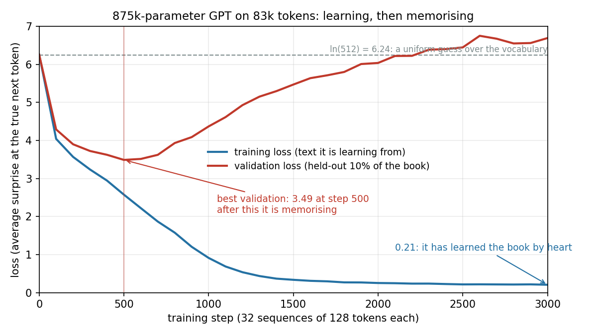

# Chapter 8: Loss and Gradient Descent: Nudging a Million Knobs

*LLMs 101, Part II — Growing the Brain.
[Series index](index.html) · [Prev](07-the-whole-transformer.md) ·
[Next: Pretraining](09-pretraining.md)*

---

**The failure:** chapter 7 loaded 124 million numbers from a file and they
were already right. Start from random numbers instead and the same code
produces noise. The numbers have to come from somewhere, and "training" is
the word for where. Here's what it is:

> **Training is a loop with three steps.** Measure how surprised the model
> is by the true next token (the **loss**). Work out, for every one of the
> weights, which direction would make that surprise smaller (the
> **gradient**). Nudge every weight a tiny step in its direction. Repeat a
> few million times. That's gradient descent, and it's the only learning
> algorithm in this book. Pretraining, fine-tuning, RLHF and reasoning
> training are all this loop with a different definition of "surprise."

The body book said "trained" thirty times and defined it zero. This
chapter is the definition, demonstrated on a model small enough to train
while you make coffee.

## Loss: a number for "how wrong"

The model outputs a probability for every token. The training text tells
you which token actually came next. The loss for that position is the
negative log of the probability the model gave to the true token:

> loss = −log p(true next token)

If the model gave the true token probability 1, the loss is 0. If it gave
it 0.05, the loss is 3.0. If it gave it 0.001, the loss is 6.9. Confidently
wrong is punished hard; hedging across a few plausible options is punished
gently. This is **cross-entropy**, and averaged over a batch of positions
it's the single number a training run tries to push down.

Two reference points make the number readable. A model that spreads
probability evenly over a 512-token vocabulary gives every token 1/512, so
its loss is ln(512) = 6.24 everywhere. That's the "knows nothing" score. And
a loss of 3.5 means the model gives the true token e^−3.5 ≈ 3% on
average, which is like being sure it's one of about 33 equally likely
tokens. People call that 33 the **perplexity**: how many ways the model is
torn, on average. Frontier models on web text sit around a loss of 2 or
below, a perplexity in the single digits. Every token, they've narrowed it
to a handful of choices.

## Gradient: which way is down

Now the step that makes the whole thing work. The loss is a function of
the model's weights: change any one of the 875,000 numbers a little and the
loss changes a little. The **gradient** is the list of all 875,000 of those
sensitivities, computed at once. It says, for every weight, "increase me and
the loss goes up by this much; decrease me and it goes down."

Computing that list sounds impossible and is a mechanical application of
the chain rule from first-year calculus, run backwards through the network
from the loss to each weight. The algorithm is **backpropagation**, and
you never write it. Every framework records the operations of the forward
pass and replays them in reverse to produce the gradient. In PyTorch that
is one line, `loss.backward()`. If you want to see the calculus done by
hand on a network small enough to follow, Appendix A does it. For
everything else in this book, "autograd" means: the derivative comes for
free.

Then the nudge. For every weight, subtract a small multiple of its
gradient:

> weight ← weight − learning_rate × gradient

The **learning rate** is the size of the step. Too big and you overshoot
and the loss bounces or explodes; too small and training takes forever.
In practice everyone uses **Adam**, an optimiser that scales each weight's
step by how consistent its gradients have been recently, so noisy weights
move cautiously and steady ones move faster. You set one learning rate and
Adam does the rest.

That's the loop. Everything a model knows is the accumulated effect of a
few million tiny nudges, each chosen to make one batch of text slightly
less surprising.

## The toy, trained

[`gpt/v4_train.py`](https://github.com/IsuruMaduranga/harness-engineering-101/blob/main/llms-101/src/gpt/v4_train.py)
is chapter 7's model rewritten in PyTorch (so gradients are free) and
trained on the text of *Harness Engineering 101*, tokenized by chapter 2's
BPE with a vocabulary of 512. Four blocks, four heads, 128-dimensional
vectors, a 128-token context. The training core is this:

```python
def get_batch(split):
    ix = torch.randint(len(d) - BLOCK - 1, (BATCH,))
    x = torch.stack([d[i:i + BLOCK] for i in ix])            # 128 tokens of context ...
    y = torch.stack([d[i + 1:i + BLOCK + 1] for i in ix])    # ... and the token after each one
    return x, y

for step in range(STEPS):
    x, y = get_batch("train")
    logits = model(x)
    loss = F.cross_entropy(logits.flatten(0, 1), y.flatten())   # surprise at the true next token
    opt.zero_grad(); loss.backward(); opt.step()                 # which way to nudge, then nudge
```

Look at `y`. It's `x` shifted one token to the right. Because of the causal
mask (chapter 5), position *i*'s output only saw positions up to *i*, so
every one of the 128 positions in a sequence is a legitimate training
example for predicting position *i+1*. One 128-token sequence gives 128
loss terms, and a batch of 32 sequences gives 4,096, all computed in one
forward pass. This is why the causal mask isn't just a correctness detail:
it's what makes training on whole documents at once possible.

Run it:

```
875,264 parameters, 82,774 training tokens, vocab 512
random-guess loss would be ln(512) = 6.24
step     0  train 6.255  val 6.254  (1s)
step   100  train 4.040  val 4.289  (11s)
step   200  train 3.567  val 3.899  (21s)
step   500  train 2.574  val 3.488  (50s)
step  1000  train 0.912  val 4.369  (101s)
step  3000  train 0.207  val 6.691  (302s)
```

Step zero: 6.255 against a predicted 6.24. Before any training, the model
is a uniform guesser, exactly as the arithmetic said. Then the loss falls
fast: after a hundred nudges it has learned which tokens are common; after
five hundred it's giving the true next token about 3% on average on text it
has never seen. Then something goes wrong, and it's the most important
thing on the chart.



## Two losses, and the moment learning turns into memorising

`val` is the loss on the last 10% of the book, which the model never trains
on. Up to step 500 both losses fall together: the model is learning things
about the book's English that are *true of text it hasn't seen*. After
step 500 the training loss keeps falling, all the way to 0.21, which is
"I know the next token with 80% confidence" on average, while the
validation loss climbs past where it started. The model has stopped
learning the language of the book and started learning the *book*. With
875,000 parameters and 83,000 tokens, it has ten numbers to spend on every
token it has to remember, and it spends them.

You can see the memorisation directly. Sample from the final weights and
you get this, lifted nearly verbatim from the training text, navigation
line and all (the original says "Chapter 14"; the model dropped a digit,
which is what a compression artefact looks like):

```
The harness much that has to does nothing to be attention. ...

*[Next: Chapter 4 — Case Study: Coding Agents](14-coding-agents.md)*

# Chapter 14: Case Study: Coding Agents

*Harness E
```

Sample from the step-500 weights instead, the ones with the best
validation loss:

```
The harness, user, run the text ter see to behavior tokens. Call like answer
training ght token generation matchebeanly because they are requeuch; "cosed"
is a changed."

## The `resystem` the model calls are the will state mid000 do not one
```

Nonsense, but *original* nonsense in the book's voice: markdown headers,
backticked identifiers, the word "tokens" in a sentence about behaviour.
That's what 500 steps of gradient descent on 83k tokens can learn. It
learned the texture and none of the meaning, and the reason is in the next
chapter: there isn't enough text here for meaning to be the cheapest way to
lower the loss.

This split, **train loss versus held-out loss**, is the single most
important diagnostic in all of machine learning, and now you've watched it
happen. Every lab watches the same two curves at a scale where the run
costs millions, and the entire craft of choosing model size, data size and
stopping time is about keeping them together.

## What "learning" was, mechanically

I want to close by deflating the word. Nothing in this chapter chose to
learn anything. A number was computed. Derivatives were taken. Weights
moved a millionth of a unit each. The embedding rows from chapter 3 drifted
until tokens used alike sat together. The attention matrices from chapter 5
drifted until some heads looked at the previous token. The MLP weights from
chapter 6 drifted until they encoded which token follows "the." Each drift
happened because it lowered one batch's surprise by a hair, and a million
hairs added up.

That's the whole mechanism, and it's the same mechanism for every stage in
Part II. What changes is the *signal*: the definition of surprise. Next
token, in pretraining. Preferred reply, in post-training. Correct answer,
in reasoning training. Same loop, different loss.

## What you now know

- Loss is the negative log probability of the true next token: confidently
  wrong costs the most. ln(vocabulary size) is the "knows nothing"
  baseline; perplexity is e^loss, the number of ways the model is torn.
- The gradient is the sensitivity of the loss to every weight at once, from
  backpropagation. Training subtracts a small multiple of it, millions of
  times. Adam sets the step sizes.
- The causal mask turns every position into a training example, so one
  sequence yields hundreds of loss terms in one pass.
- Watch two losses. When the held-out one rises while the training one
  falls, the model has switched from learning to memorising. The toy did
  it at step 500, and you can read the memorised text in its output.
- Every training stage in Part II is this loop with a different loss.

*[Next: Chapter 9 — Pretraining: Compression of the Internet](09-pretraining.md)*
