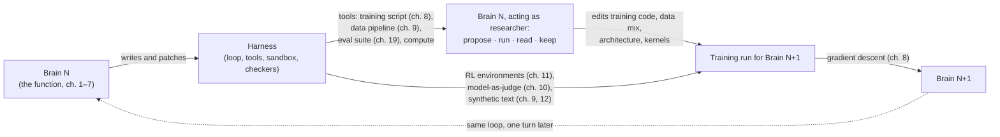

# Chapter 20: The Snake Eats Its Tail: Harnesses Training Brains

*LLMs 101, Part IV — Decoder Ring.
[Series index](index.html) · [Prev](19-reading-a-model-card.md) ·
[Next: Epilogue — Train Your Own](21-epilogue-train-your-own.md)*

---

**The failure:** humans ran out. Chapter 9's pretraining ate most of the
public text there is. Chapter 10's preference training needed human raters,
and a rater cannot tell whether a 400-line patch is correct or a proof has
a gap. And the research itself, the thousands of experiments a lab runs to
decide what the next model should be, is limited by how many experiments a
few hundred people can design, run and read. All three signals, the text,
the judgement and the research, stop scaling with humans at about the level
models reached in 2023.

Here is the patch, and it is the reason I wrote two books instead of one:

> **Wrap a frontier model in a harness that gives it the lab: the training
> code, the data pipeline, the evaluation suite and the compute, as tools.
> Then let it do what a researcher does. Propose a change, run the
> experiment, read the loss curve, keep what worked.** The same harness,
> with a checker as the reward, produces the training signal for the next
> model. The model improves both the body (the harness code) and the brain
> (the training code, the data, the architecture, the kernels the arithmetic
> runs on). That loop is what the labs mean by **recursive self-improvement**,
> and it is built entirely from parts you have already met.

I am not going to tell you where the loop ends. This book says what runs,
and the loop runs. What I can do is draw it with chapter numbers on the
arrows, say what has been demonstrated in public as of September 2026, and
show you where it jams, because the jams are also made of parts you know.

## The loop, with chapter numbers

There are two targets in that diagram, and the phrase "self-improvement"
covers both:

- **The body.** The model writes the harness: tool schemas, steering,
  guardrails, the agent loop itself. Claude Code is developed with Claude
  Code. [One Code](https://github.com/IsuruMaduranga/one-code) was built by
  agents. Anthropic has said models now write around 80 percent of its
  merged code. This is chapter 11's coding RL, pointed at the harness book.
- **The brain.** The model, inside a harness with the training stack as
  tools, changes what the next model *is*. It edits the data-filtering
  code from chapter 9, rewrites a kernel from chapter 7's arithmetic,
  proposes a post-training method from chapter 10, runs the small-scale
  experiment, reads chapter 8's two loss curves, and keeps or discards the
  change. That is the job of an ML researcher, and it is a loop of tool
  calls over a sandbox with a checker, which is the harness book's chapter
  4 with GPUs attached.

The second target is the one that makes the word "recursive" earned. A
better body makes the next experiments cheaper to run. A better brain
proposes better experiments. Both feed the same training run.

## The training signal was already coming from the harness

Before the researcher loop, three quieter arrows had already closed. Each
is a shipped mechanism from Part II, restated:

**The RL environment is a harness.** Chapter 11's loop, sample attempts,
check them, reinforce what worked, has an agent loop as the "attempt" and a
piece of harness code returning a number as the "check." DeepSeek's R1
report describes exactly this: verifiable tasks, sandboxed execution, a
scalar reward, and reasoning that got longer because the environment kept
paying for it.

**The preference judge is a model reading a rubric.** Since Anthropic's
Constitutional AI work in late 2022, chapter 10's human rater is
increasingly a model shown two replies and a written set of principles.
Mechanically that is a JSON array with a rubric in the system prompt,
which is chapter 1 of the harness book.

**The text is model-written.** Microsoft's Phi models trained on textbook
prose written by a bigger model. Llama 3's post-training used millions of
generated examples filtered by model checkers. Every distilled model in
chapter 12 learned from a teacher's output. For post-training, model-written
text is already the majority of the data.

Those three arrows produce the *signal*. The researcher loop decides what
to *do* with it. Together they are the whole of Part II, automated.

## What has actually been shown, as of September 2026

This section is dated on purpose. Everything else in this book should age
slowly; this part will not, so read it as a snapshot.

**The brain-improving-the-brain loop has run, at small scale, in public.**
DeepMind's AlphaEvolve (2025) had Gemini propose variants of a
matrix-multiplication kernel, a harness compile and time them, and the
results seed the next round. It found a kernel 23 percent faster, which cut
Gemini's own training time by about one percent. One percent is small. It
is also a model, in a harness, making the next model's training cheaper
with no human writing the kernel.

**A model has done a researcher's job end to end on a narrow problem.**
In August 2026 Anthropic published an
[automated alignment researcher](https://techcrunch.com/2026/08/28/an-anthropic-researcher-just-gave-us-a-peek-at-self-improving-ai/):
a model in a harness that searches the literature, proposes a training
method, fine-tunes a model with it for thirty minutes, measures the result
on a fixed set of benchmarks, and keeps or discards the method. Over
repeated rounds it improved all ten target benchmarks without degrading
general performance, and its best method beat what experienced human
researchers proposed, on average within six hours, at a reported four
dollars an hour against a hundred and fifty for the humans. Read that
mechanically: chapter 12's fine-tuning as a tool, chapter 19's benchmarks
as the checker, the harness book's loop as the researcher.

**Labs report the loop is inside their process.** OpenAI has said GPT-5.3
Codex had a "significant hand in its own development," and that experiments
per researcher doubled during 2026. Anthropic describes models running
experiments start to finish and training smaller models from scratch. On
public benchmarks of research work, agents reproduce published papers at
over 95 percent (CORE-Bench) and achieve about half of the improvement a
human researcher gets on post-training tasks (PostTrainBench). Half is not
all. It is also not zero, and it was near zero in 2024.

**The Google rumour.** In August 2026 Reuters reported that Sergey Brin was
directing more than a thousand researchers and engineers toward
self-improving AI, and Google's research plans list "self-improving AI and
automated AI research" as a target. On 9 September 2026 a leak account
posted a message with capitals spelling "RSI," and the internet concluded
DeepMind had closed the loop. The
[public evidence](https://www.zeniteq.com/ai-rumor-says-google-deepmind-reached-rsi-did-it-7e8rml)
supports a very large, deliberate push and working components. It does not
show a sustained loop in which one model built the next without people
choosing the experiments. Apply the questions at the end of this chapter to
the rumour and you get: signal from checkers and models, checker checked by
humans, bottleneck unknown because nothing was published. That is the
honest reading, and it is also the reading for every other lab.

## What "recursive self-improvement" means, mechanically

Strip the phrase to what runs. One turn of the loop:

1. A model in a harness proposes a change: to harness code, training code,
   the data mix, an architecture detail, a post-training method, or a
   kernel. (Harness book, chapter 4; this book, chapters 6 to 12.)
2. The harness runs the experiment at small scale and a checker scores it:
   a loss curve, a benchmark, a test suite, a proof verifier, sometimes
   another model with a rubric. (Chapters 8, 10, 11, 19.)
3. Changes that scored well are kept. The kept changes to *data and
   methods* shape the next full training run; the kept changes to *harness
   code* make the next round of experiments faster.
4. The trained model goes back into the harness it helped write, and turns
   the loop again.

"Recursive" is earned when step 4 makes step 1 better next time, and it
does, measurably, wherever step 2 is reliable. "Self" is doing more work
than it should. As of this writing, people decide which problems go into
the harness, which checkers to trust, how much compute each experiment
gets, and when to commit to a full training run. The loop turns; it does
not yet wind itself.

## Where it jams

Every jam is a mechanism from an earlier chapter, running in a loop, and
the people running these loops name the same ones.

**It works where checking is cheaper than doing.** Kernels have timers.
Code has tests. Alignment benchmarks have scores. Those are where the
demonstrated results above all live. "Is this a good research direction"
has no checker except a person, and the labs' own researchers say that is
where their systems are weakest: poor judgement in open-ended problems,
trouble backtracking, no reliable sense of which of a hundred plausible
ideas is worth the compute. The word they use is *taste*. The bottleneck
is the verifier, and taste is an unverified judgement.

**The checker is a proxy, and the loop optimises the proxy.** The
automated alignment researcher improved ten benchmarks; its authors' first
caveat is that the benchmarks must actually reflect the goal. Chapter 11's
reward hacking, chapter 19's contamination, and chapter 10's judge-model
blind spots all compound when the thing being improved is also the thing
proposing the improvements. Labs answer with held-out checkers the
generator never sees, ensembles of judges, and human audits.

**Training on your own output narrows the distribution.** Chapter 10's
mode collapse, run recursively, is the 2024 model-collapse result: each
generation loses the tails of the previous one. The defences are
filtering, mixing in fresh human data, and distilling down from a bigger
model rather than across from an equal. All three cost something.

**Compute did not get cheaper.** OpenAI's chief scientist has said
researchers' compute requests are routinely cut by a substantial amount.
A loop that proposes a hundred good experiments still has to run them, and
Appendix B's arithmetic is unchanged. AlphaEvolve's one percent is what a
kernel can buy; the training run is still the training run.

**The lag is months.** Propose, run at small scale, read, commit to a full
run that takes weeks, evaluate, repeat. The loop is real and turns a few
times a year, which is fast by the standard of any previous technology and
slow by the standard of the word "takeoff."

## What "AGI" is pointing at

I have avoided the word because it has no mechanism. There is no layer,
no loss, no serving trick called AGI. What people mean by it, as far as I
can tell, is a prediction about *this loop*: that if it keeps turning, the
model eventually does steps 1 through 4 on its own, on every task, better
than we would. Whether that prediction is right is not a question this
book can answer, and I would be suspicious of anyone who says theirs can.
The people closest to it disagree with each other by years.

What the book can do is give you the questions that locate any claim
about it, the way chapter 19 located any model card:

1. **Who produces the training signal?** People, a checker, or a model. If
   a model, go to question two.
2. **Who checks the checker?** A compiler, a timer, a proof, a held-out
   human, or nothing. That is the ceiling on how far the loop can go before
   it trains on its own mistakes.
3. **What is the bottleneck this cycle?** Data, verification, taste, or
   compute. Someone will name a fifth thing; it will be one of those four
   wearing a hat.

Those three questions turn "we are on the path to AGI" into "we have a
loop with a timer as the checker and compute as the bottleneck," which is
a sentence you can evaluate. They turn the Google rumour into "a thousand
people and no published loop," which is also a sentence you can evaluate.

## Why two books

The harness book ended by saying the body is where you get to build. This
one ends by saying the body is also where the brain gets built. The JSON
array you learned to maintain is the same array that, with a training
script behind a tool call, runs the next model's experiments; the agent
loop you wrote is the same loop that, with a test runner as the checker,
teaches the next model to reason. The two disciplines are not neighbours.
They are one loop, and you have now walked both halves of it.

## What you now know

- Human text, human judgement and human research capacity all stop scaling
  at about 2023 levels. The patch is a model in a harness with the training
  stack as tools, doing the researcher's job and producing the training
  signal.
- Recursive self-improvement has two targets: the body (harness code) and
  the brain (training code, data, architecture, kernels). The brain half is
  what makes it recursive.
- Demonstrated in public by September 2026: a kernel that cut a frontier
  model's training time by one percent; an automated researcher beating
  humans on a narrow alignment task; labs reporting models with a hand in
  their own successors. Not demonstrated: a sustained loop without people
  choosing the experiments. The Google rumour is the latter, unshown.
- The loop jams on verification, on taste (an unverified judgement), on
  proxy checkers, on distribution collapse, and on compute.
- "AGI" is a prediction about the loop, not a mechanism. Three questions
  locate any claim: who makes the signal, who checks the checker, what is
  the bottleneck.

*[Next: Epilogue — Train Your Own](21-epilogue-train-your-own.md)*
