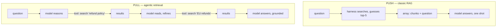

# Chapter 15: RAG Was a Harness Pattern All Along

*Harness Engineering 101, Part IV — Trust, Domains, and Data.
[Series index](index.html) · [Prev](14-coding-agents.md) ·
[Next: Epilogue — Build Your Own](16-epilogue-build-your-own.md)*

---

**The failure, one last time:** the model doesn't know your stuff. Chapter
2 explained why: its knowledge is a compression of public training text,
frozen at a cutoff. Your company wiki, your codebase, and yesterday's
support tickets aren't in the weights, and (chapter 6) they're too big to
paste into the array whole.

Around 2023 the standard answer to this got a name, an ecosystem, and a
scary-looking body of research: **RAG**, Retrieval-Augmented Generation.
Vector databases, embeddings, chunking strategies, and then the long list of
types: naive RAG, advanced RAG, hybrid RAG, graph RAG, corrective RAG,
self-RAG, re-ranking pipelines. There are entire conference tracks on it. If
you came into this series with anxiety about that list, this chapter is the
payoff, because you now have the one sentence that organizes all of it:

> **RAG is deciding what goes in the array, nothing more. Every variant is a
> different answer to "which text, chosen how."**

## Classic RAG, in harness terms

In this series' vocabulary, the original pattern is that the harness
retrieves before the model speaks. The user asks a question. The harness
(not the model) searches a document store for relevant chunks, and the
winners get pasted into the array next to the question. The model then
answers, now "grounded" in text it was handed.

```python
def rag_answer(question):
    chunks = search(question, top_k=5)          # the harness decides
    context = "\n\n".join(c.text for c in chunks)
    messages = [{"role": "user", "content":
        f"Answer using this context:\n{context}\n\nQuestion: {question}"}]
    return call_llm(messages)
```

This is chapter 6's memory-file injection, with a search step choosing
what to inject. There is no loop, no tools, no agent. RAG predates all of
them; it was invented for the GPT-3.5-era chatbot, where the model got
exactly one shot at the array, so the harness had to guess, up front,
everything the model might need. Call this the **push** model: the body
guesses what's needed and stuffs it into the array.

The famous machinery all lives inside that `search()` call. **Embeddings**:
turn text into vectors such that similar meanings land near each other, so
"how do I get my money back" finds the refunds policy despite sharing no
words. **Chunking**: split documents into retrievable pieces. **Vector
database**: store the vectors, find nearest neighbors fast. This is all
real engineering, but it's *search-index engineering*: none of it touches
the model or the loop. Embedding search is one search method among
several, better than keyword search at synonyms and fuzz, worse at exact
identifiers and rare tokens (which is why production search is usually
**hybrid**: run both, merge). If you remember that an embedding index is
"grep for meaning," you know enough to build with it.

## The zoo, decoded

Each variant in that list answers "which text, chosen how" with one extra
step:

| The name | What it actually is |
|---|---|
| Naive RAG | one vector search, top-k pasted in |
| Hybrid RAG | two search methods (keyword + vector), merged |
| Re-ranking | a second, better model re-sorts the candidates before pasting |
| Graph RAG | the index is entity links, not just chunks: search can follow relationships |
| Corrective / self-RAG | check the retrieved text (often with a model call) and re-search if weak |
| Agentic RAG | give the model the search as a *tool* and let it drive |

The right-hand column holds index choices, ranking choices, and retry
logic. That's legitimate search engineering, but none of it is
conceptually new. There is no need to memorize a dozen RAG names when you
can remember that a search index has quality knobs, and people keep naming
the knobs.

The last row matters more than the others, though, because it moves the
decision to the model.

## Push vs pull: the real dividing line

This series built an agent that reads files *on demand*: the model
notices it needs `backoff.ts`, calls a tool, and the result lands in the
array. Apply that to documents and you have **agentic retrieval**: expose
`search_docs` as a chapter 3 tool, and let the *model* decide what to look
up, read the results, and search again with a refined query if the first
pass missed.



Push versus pull is the real dividing line in this whole subject, and the
trade is exactly the one you already know from chapter 6 ("don't inject
what the model can fetch"):

**Pull wins on quality**, for the same reason a librarian beats a
conveyor belt. The push harness must guess relevance from the question
alone, in one shot, before any reasoning happens, and if it guesses wrong,
the model answers confidently from the wrong pages. The pull model
formulates its *own* queries mid-reasoning, sees the results, notices they
are off, and searches again, so the retrieval has a feedback loop in it.
Multi-hop questions ("compare our refund policy with the one we had before
the rebrand") are nearly impossible to pre-fetch and natural to pull.

**Push wins on cost and latency.** It takes one search and one model call.
A pull loop is several rounds of an expensive brain. For a
high-volume support chatbot answering single-hop questions over a clean
document set, classic push RAG remains the correct engineering answer, and
"agentic" would be waste. Push is also the only option when there is no
loop at all: batch pipelines, one-shot API products, strict latency
budgets.

So the design rule is to pull when reasoning should steer the reading,
and push when the reading is predictable. The two also compose. A fine
pattern is a cheap push (paste an obviously relevant page) plus pull tools
for everything else. A coding agent already works this way: the memory
file is push and grep is pull.

The last connection is one chapter 7 promised: when the pulling gets long,
do it in a subagent. Searching a large document set produces a lot of
intermediate text and a short final answer, so fork a subagent, let the
child spend its own context searching and reading, and keep the cited
summary. "Deep research" products are roughly this pattern, packaged and
sold.

## What this chapter is really about

I picked RAG for the finale because it's the cleanest demonstration of
what this series has tried to teach, even if you won't build one tomorrow.
From outside, RAG looks like a subfield, with its own acronym, vendors,
and list of types to memorize. From inside the harness view, it's fifteen
chapters of familiar parts. There's a stateless array (ch. 1) that must be
filled and a budget (ch. 6) that forces selection, then push injection
(ch. 6 memory, ch. 8 steering) or pull tools (ch. 3) in a loop (ch. 4),
maybe forked (ch. 7). The only genuinely new piece is the search index
with its quality knobs, and that isn't an AI component at all.

The same collapse happens to most of the field's proper nouns when you
look from in here: frameworks (ch. 10), MCP and skills (ch. 11),
multi-agent systems (ch. 7), agentic this and autonomous that. The next
acronym will arrive on schedule. When it does, ask the questions this
series trained you to ask: *what ends up in the array? who decides, brain
or body? what does it cost, and what enforces it?* Their answers tell you
where anything fits.

## What you now know

- RAG is choosing what goes in the array, with a search index doing the
  choosing.
- Push means the harness guesses up front. Pull means the model searches
  while it reasons. Most systems need both.
- Most of the field's names turn into simple questions about the array once
  you look at it this way.

The epilogue puts all the pieces together by walking through the complete
toy harness: fifteen chapters in about 300 lines of Python that you can
run, break, and rebuild.

*[Next: Epilogue — Build Your Own](16-epilogue-build-your-own.md)*
